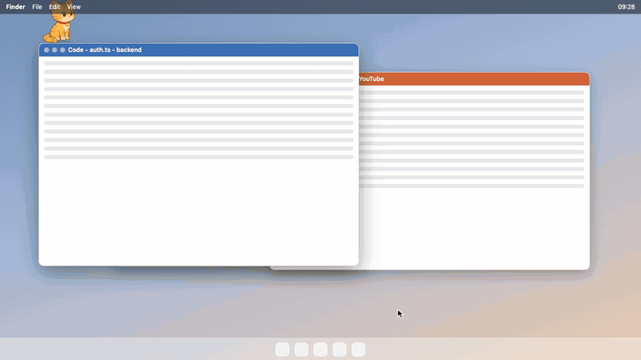
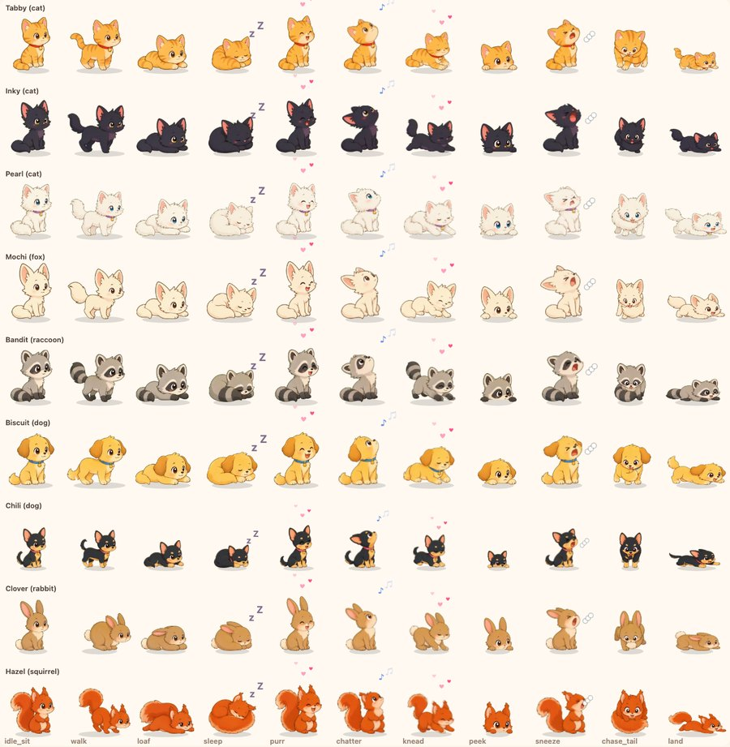
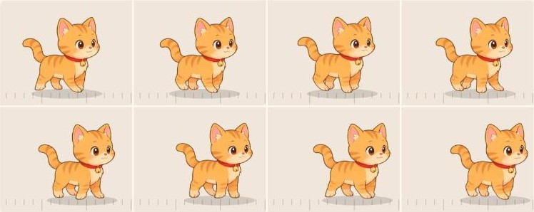

# Felinquent

A cat that lives on your desktop and does whatever it wants.



**Website: [abozaralizadeh.github.io/Felinquent](https://abozaralizadeh.github.io/Felinquent/)**. The clip above is the browser playground, which runs the same brain and animals as the Mac app on pretend windows.

It walks along the tops of your windows, naps on the Dock, sits on the thing you're reading and ignores you when you call it. Pet it and it purrs, for a while. Poke it and it reacts like the animal it is. It's not useful, and that's the point.



There are six characters: three cats (Tabby, Inky, Pearl), a fox (Mochi), a raccoon (Bandit) and a dog (Biscuit). Each has its own instincts. The cats nap and ignore you, the dog comes running, the fox stalks, the raccoon steals.



**Status: early.** The brain, rules, movement and animation are built and tested, and a browser playground runs all of it on pretend windows. The Mac app is a working prototype: a transparent overlay where the cat stands on your real windows. Windows support is written but has never been run.

## Install on a Mac

[Download Felinquent.dmg](https://github.com/abozaralizadeh/Felinquent/releases/latest/download/Felinquent.dmg), open it and drag Felinquent into Applications. It needs macOS 13 or newer and runs on Apple Silicon and Intel.

The first time you open it, macOS says it can't check the app, because it isn't signed with an Apple Developer ID yet. Click Done, open System Settings > Privacy & Security, scroll down and click Open Anyway. You only do this once.

Or skip that step and paste this in Terminal. It downloads the same app, checks it against the checksum on the release, puts it in Applications and starts it, with no warning:

```bash
curl -fsSL https://raw.githubusercontent.com/abozaralizadeh/Felinquent/main/scripts/get-mac.sh | bash
```

After that it lives in the menu bar. Pick a character, set the chaos level, hide it, shoo it for an hour, turn the local model on or off, make it start at login. A tick shows what's on. From 0.1.2 it checks GitHub for a new version twice a day and asks before it updates itself. More in [docs/INSTALL.md](docs/INSTALL.md), including how to build it yourself.

## What it will and won't do

- It can get in your way, on purpose. It never types, clicks, scrolls, moves your cursor, closes anything or sends anything. A check in CI fails the build if code that fakes input shows up.
- No screenshots or screen capture, ever. It reads window positions, idle time and whether the camera or mic is on, nothing else.
- It backs off in meetings, fullscreen and screen sharing, and there's a panic hotkey.
- Everything runs locally. No accounts, no analytics, no cloud. The one thing it fetches is the update check, a small file from GitHub with nothing about you in it, and you can turn it off. An optional small local model (through [Ollama](https://ollama.com)) can pick what the cat wants to do. Without it a rules brain does the same job.

The full list is in [docs/safety-and-privacy.md](docs/safety-and-privacy.md).

## Try it in the browser

No install, just the playground. You need [Node.js](https://nodejs.org) 22 or newer.

```bash
npm install
npm run dev
```

Open http://localhost:5173. Drag the pretend windows, hover over the cat to pet it, drag it to pick it up, shake it to shoo it, click it to poke it. Try the Meeting and Panic switches, and the chaos level.

To build the Mac app from source instead of downloading it (needs Rust):

```bash
bash scripts/install-mac.sh
```

## Tests

```bash
npm run typecheck
npm test                   # unit and simulation tests (hours of simulated cat life)
npm run check:forbidden    # fails if any code fakes input or captures the screen
npm run build
npm run eval -- --brain rules    # scores a brain on repeatable scenarios (also: fake, ollama)
npm run pace -- 60 biscuit       # how busy an animal looks over a simulated hour
```

## How it works

A slow brain (rules, or a small local model) decides what the cat wants every 20 to 60 seconds. It can only pick from a menu that the rules and a governor prepare, and the governor approves every action. A fast layer moves the cat, plays the animation and handles your pointer. The Mac shell is [Tauri](https://tauri.app): one transparent, click-through window per display.

| Doc | What's in it |
|---|---|
| [docs/LOGICAL-FLOW.md](docs/LOGICAL-FLOW.md) | How the cat thinks and moves, step by step |
| [docs/DESIGN.md](docs/DESIGN.md) | Module map, the seams, how to extend it |
| [docs/technical-design.md](docs/technical-design.md) | Architecture, the intent schema, the governor |
| [docs/behavior-catalog.md](docs/behavior-catalog.md) | Every behavior, reflex and respect mode |
| [docs/art-and-ux.md](docs/art-and-ux.md) | The look, the animation list, the art tools |
| [docs/safety-and-privacy.md](docs/safety-and-privacy.md) | The hard lines and the data it touches |
| [docs/spikes/](docs/spikes/README.md) | Notes from the prototype runs on a real Mac |
| [docs/INSTALL.md](docs/INSTALL.md) | Install on a Mac, Windows (untested) or a Linux server for the demo |

## Contributing

Issues and pull requests are welcome. Keep the hard lines: no synthetic input, no screen capture, nothing destructive to other apps, and the governor approves every action. Run the checks above before you open a pull request. A new behavior needs a row in the behavior catalog and a test. The details, and what you agree to when you send code, are in [CONTRIBUTING.md](CONTRIBUTING.md).

## License

Felinquent is source available, free for non-commercial use. Personal use, hobby projects, research, schools and charities are all fine. Selling it or using it in a commercial product isn't, unless you ask first.

- Code: [PolyForm Noncommercial 1.0.0](LICENSE)
- Art (sprites, icons, images): [CC BY-NC 4.0](LICENSE-ART.md)
- Other people's work it uses, including the optional Gemma model: [THIRD_PARTY_NOTICES.md](THIRD_PARTY_NOTICES.md)

The character art is AI-assisted and animated in code.
