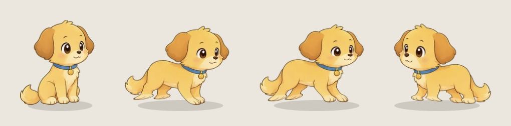

# Make your own character

You can give Felinquent a new animal: your own pet, a mascot, a little monster. A character is a folder of drawings plus one small `character.json`. You pack the folder into a single `.felinquent` file, and anyone can add it in the app with **Character > Add a character…** (in the menu bar menu on a Mac, the tray menu on Windows, or the menu you get by right-clicking the animal).

A package is only pictures and settings. The app never runs anything from it, and it checks every file before it uses one.

This guide starts with the smallest character that works (two drawings) and then adds life to it step by step. Stop wherever you like: every step on its own already makes a working character.

You need:

- Felinquent 0.1.18 or newer to add a package.
- This repo and Node 22 or newer (`npm install` once) for the checker and the packer.
- For the optional art tools: Python through [uv](https://docs.astral.sh/uv/). The tools install what they need on the first run.

## The smallest character: two drawings

Make a folder like this:

```
pickle/
  character.json
  sprites/
    sit.webp
    stand.webp
```

`sit.webp` is your animal sitting and `stand.webp` is it standing on all fours (or on two feet, if that's how it stands). Both seen from the side and facing right.

`character.json` says who it is:

```json
{
  "format": 1,
  "id": "pickle",
  "name": "Pickle",
  "blurb": "A sleepy pup who thinks the Dock is a sofa.",
  "kind": "dog",
  "species": "puppy",
  "toy": "tennis",
  "color": "#c98a4b",
  "traits": { "laziness": 0.7, "neediness": 0.5, "chaos": 0.3, "aloofness": 0.2, "curiosity": 0.6 }
}
```

Then check it and pack it, from the repo folder (the character's folder can be anywhere, give its path):

```bash
npm run character -- check pickle
```

```bash
npm run character -- pack pickle
```

`check` reads `character.json` with the app's own code and looks at every file the way the app will, so a package that passes here gets in. It also tells you which drawings are still missing (lots, for now). `pack` checks again and writes `Pickle.felinquent`.

In the app, pick **Character > Add a character…** and choose the file. It switches to Pickle straight away. **Character > Remove a character** takes it out again. Adding a package with the same `id` again replaces the old copy, so you can keep improving it.

With only two drawings Pickle already does everything the other animals do: naps on windows, chases the cursor, begs for treats. It just does it all in one of those two drawings, sliding along when it walks. The next steps fix that.

## How to draw

- **Face right.** The app mirrors a drawing when the animal goes left.
- **Transparent background, cropped tight.** No empty space around the drawing. The bottom edge of the picture is put on the ground, so crop right down to the lowest pixel.
- **Draw at the size of the built-in animals.** The app draws every pixel at a fixed scale, so a bigger picture makes a bigger animal. The built-in sitting drawings are about 280 to 300 pixels tall and the standing ones about 330 to 360 pixels wide.
- **One animal, one size.** The same head should be the same size in every drawing. (The art tools below can even out small differences.)
- **WebP with transparency.** Most image editors export it, or use `cwebp -q 92 -alpha_q 100 sit.png -o sit.webp`. Built-in frames are 20 to 60 KB each.
- **File names** are the frame name plus `.webp`: lowercase letters, digits and `_` only.

To see what any frame looks like on a built-in animal, open its file in `src/playground/public/sprites/<animal>/`, for example `src/playground/public/sprites/biscuit/loaf.webp`. Biscuit is the dog, Tabby the cat, Mochi the fox, Bandit the raccoon, Clover the rabbit and Hazel the squirrel.

## Make it walk (one command)

For an animal on four legs, one tool turns `stand.webp` into a real walk, trot and run. It cuts the four legs out of the drawing and swings each one on its own beat, so nothing flickers:

```bash
tools/rig-gait.py pickle/sprites > pickle-gaits.json
```

```bash
npm run character -- art pickle --gaits pickle-gaits.json
```

The first command writes 76 frames into `pickle/sprites` (`gw00` to `gw31`, `gt00` to `gt23`, `gr00` to `gr19`). The second puts the length of each step into `character.json`, so the feet stay planted instead of sliding. A side view with the legs apart works best. Pack it again and the animal walks, trots and runs.



That's a test character made from just two drawings (borrowed from Biscuit) and this one command, running in the real app.

An animal that hops, like a rabbit or a squirrel, uses `tools/hop-gait.py pickle/sprites --like clover` (or `--like hazel`) instead, and one that walks on two feet uses `tools/biped-gait.py pickle/sprites`. Both need drawn steps, not just the standing drawing (see the note under the table below).

## More drawings

The app plays 726 frames. 227 of them are drawings; the rest are made from the drawings by the tools (in-betweens, licks, the gaits). Any frame that's missing is shown as a near drawing instead, mostly `sit` or `stand`, so you can add drawings a few at a time and each one brings one more move to life.

`npm run character -- frames` lists every drawing by sheet, and `check` shows which ones your character still lacks. Here they are with what they're for, roughly in the order they matter:

| Sheet | Drawings | What for |
|---|---|---|
| base | `sit` `stand` `sleep` `loaf` `groom` `jump` `crouch` `wave` | Sitting, standing, asleep curled up, resting with paws tucked in, washing, in mid jump, crouched to jump, a paw raised |
| trans | `stand2` `sitting_down` `sit2` `lowering` `loaf2` `drowsy` `curl` `deep` `waking` | Sitting down, lying down, dozing off, deep sleep and waking up |
| run | `prep` `fall` `land` | Before a jump, falling, landing |
| face | `blink` `yawn` `joy` `sulk` `surprise` `sneeze` `lookup` `meow` `curious` | Faces, sitting |
| turn | `turn_s1` `turn_s2` `turn_s3` `turn_t1` `turn_t2` `turn_t3` `slow_blink` | Turning round standing (`s`) and sitting (`t`): head turned, three quarters, facing you. The far side is your drawings mirrored |
| groom | `groom1` to `groom9` | A wash, in order |
| look | `sg_down` `sg_ahead` `sg_up` `sg_high` `sg_top` `sg_you` `sg_ear` | Sitting, only the head moves: down, ahead, up a bit, up high, straight up, at you, an ear twitch |
| lookstand | `tg_down` `tg_ahead` `tg_up` `tg_high` `tg_top` `tg_you` `tg_freeze` | The same standing, and freezing |
| gazesit | `sq_down` `sq_level` `sq_up` `sb_down` `sb_level` `sb_up` `sb_high` `sg_tilt` `sg_tiltyou` | Sitting: head three quarters toward you (`sq`), looking back over the shoulder (`sb`), a head tilt |
| gazestand | `tq_down` `tq_level` `tq_up` `tb_down` `tb_level` `tb_up` `tb_high` `tg_tilt` `tg_tiltyou` | The same standing |
| rest | `loaf_blink` `loaf_up` `loaf_back` `loaf_drowse` `sprawl_stretch` `roll1` `roll2` `belly_l` `belly_r` | Life in the loaf, and lying on its side, rolling, belly up |
| ledge | `perch_fwd` `perch_back` `perch_down` `perch_doze` `perch_kick` `perch_you` `peek_back` `peek_duck` `peek_up` | Sitting on a window's edge with the legs hanging, and peeking over one |
| life | `sleep_b` `sleep_c` `wake` `dangle` `peek` `box` `gift` `back` `rub` | Other sleeps, hanging off an edge, peeking, sitting in a box, bringing a gift, on its back, a rub |
| play | `shy` `beg` `dig` `sniff` `tumble` `sprawl` `howl` `giggle` `startled` | Play and moods |
| react | `angry` `hiss` `puffed` `annoyed` `flustered` `play_bow` `leap` `belly` `bark` | Reactions to clicks, toys and things you throw |
| joy | `bow_down` `bow_l` `bow_up` `binky` `hop_crouch` `hop_up` `hop_land` `wiggle` | The play bow, a twisting leap, hopping for joy |
| nose | `sniff1` `sniff2` `sniff3` `dig1` `dig2` `dig3` `stalk1` `stalk2` `stalk3` | Sniffing along, digging, stalking |
| voice | `howl1` `howl2` `howl3` `bark1` `bark2` `giggle1` `giggle2` `chatter1` `meow2` | Calling out, sitting |
| mood | `cross` `angry1` `angry2` `hiss1` `hiss2` `puff1` `puff2` `jumpback` | Getting cross or scared, standing |
| feel | `annoyed1` `annoyed2` `fluster1` `shy1` `beg1` `beg2` `headbutt1` `headbutt2` `proud2` | Feelings, sitting |
| paw | `paw1` to `paw9` | Sitting, a front paw reaches out and taps, comes back, then a swat |
| lick | `lick1` to `lick5`, `chest1` `chest2` `lips1` `lips2` | Licking a paw, the chest, the lips |
| scratch | `scratch1` to `scratch9` | Scratching an ear with a hind paw |
| spin | `spin1` to `spin9` | Chasing its tail, one full turn |
| seq | `stretch1` `stretch2` `stretch3` `shake` `presneeze` `sneeze2` `dazed` `retch1` `retch2` | A big stretch, a sneeze, a hairball |
| action | `stretch` `knead_a` `knead_b` `chase` `retch` `proud` | Stretching, kneading, chasing |
| extra | `tiptoe` `love` | Sneaking, in love |
| potty | `pee1` `pee2` `poop1` `poop2` `pottyback` `cover1` `cover2` `pawshake` `sheepish` | When nature calls. Skip the whole sheet with `"potty": false` |

Steps for the gait tools: a two-legged character's walk is drawn as `walk1` to `walk8` and its run as `run1` to `run6`, one step after another, for `biped-gait.py`. A hopper's hop is drawn as `walk2` to `walk6` and its bound as `run1` to `run6`, in the order `hop-gait.py` lists for Clover (or `walk2` to `walk7` for Hazel). The app doesn't play these drawings itself, so `pack` leaves them out of the package.

### Its own moves

Every kind of animal has a few moves only it does, and a character of that kind gets them too:

| Kind | Drawings |
|---|---|
| dog | `dshake1` to `dshake4` (a shake, head to tail), `chew1` `chew2` `chew3` (chewing its toy lying down), `wag1` `wag2` `wag3` |
| fox | `listen1` `listen2` `mouse_up` `mouse_top` `mouse_dive` `mouse_in` `mouse_out` `nosepush1` `nosepush2` (listening, the leap into the snow, pushing earth) |
| raccoon | `wash1` `wash2` `wash3` `inspect` `rummage1` `rummage2` `toss` `hold1` `hold2` |
| rabbit | `binky2` `thump1` `thump2` `flop1` `flop2` `nibble1` `nibble2` `earwash1` `earwash2` |
| squirrel | `nut1` `nut2` `nut3` `cheeks` `pat1` `pat2` `flick` `cling_up` `cling_down` |

A cat has none. Until you draw a kind's own moves, the animal does those moves in a near shared pose. `pack` lists the ones you drew in `character.json` for you.

## The art tools: how the built-in animals are made

The nine built-in animals are drawn on sheets of nine poses (three rows of three, on a flat green background) and finished by the tools in `tools/`. You can use the same pipeline for your character. It's more work to set up, but it gives you every in-between, lick and nod, and evens out sizes. Paths here are absolute where a tool needs it; run them from the repo root.

1. **Draw the sheets** in `art/`, named `<id>-sheet1.png`, `<id>-walk.png`, `<id>-face.png` and so on. Lay each one out in the order of the `SHEETS` table at the top of `tools/build-sprites.py`, like the built-in animal you name in the next step (`biscuit` for something dog shaped, `tabby` for a cat).
2. **Cut them into frames:**
   ```bash
   tools/build-sprites.py art all --pack pickle=biscuit --out build/frames
   ```
3. **Make the blink** from the sitting drawing with the eyes closed:
   ```bash
   tools/patch-blink.py build/frames/pickle
   ```
4. **Make the in-betweens** (about 6 minutes):
   ```bash
   LIKE=biscuit tools/tween-all.sh "$PWD/build/frames/pickle"
   ```
5. **Make the gaits** (`hop-gait.py` or `biped-gait.py` instead, as above):
   ```bash
   tools/rig-gait.py build/frames/pickle > build/gaits.json
   ```
6. **Find the paws.** In a sitting drawing the tail often hangs lower than the paws; this measures how far, so the paws touch the ground:
   ```bash
   FELINQUENT_SPRITES=build/frames tools/measure-ground.py --json build/ground.json
   ```
7. **Even out the head size and find the mouth** (where the toy goes when it carries one). The tool needs to know where the head is on your `sit` and `stand` drawings: a JSON file with an outline round the head and the mouth's spot, shaped like one entry of `REFS` in `tools/measure-heads.py`:
   ```bash
   FELINQUENT_SPRITES=build/frames FELINQUENT_PACK=pickle=biscuit FELINQUENT_PACK_REFS=heads-refs.json tools/measure-heads.py --only pickle --json build/heads.json --no-write
   ```
8. **Put the tables in `character.json` and pack**, taking the drawings from the build folder:
   ```bash
   npm run character -- art pickle --sprites build/frames/pickle --gaits build/gaits.json --ground build/ground.json --heads build/heads.json
   ```
   ```bash
   npm run character -- pack pickle --sprites build/frames/pickle
   ```

## Try it before you pack

The browser playground plays an unpacked character straight from its folder, with the same brain the app uses:

```bash
npm run dev
```

Then open `http://localhost:5173/?pack=/full/path/to/pickle`. To check the drawings frame by frame, `http://localhost:5173/characters.html?pack=/full/path/to/pickle&only=pickle` shows every animation as a strip. The playground expects `character.json` and `sprites/` in that folder, so put your drawings there (or link `sprites` to your build folder) for this.

## character.json

Everything but `format`, `id` and `name` is optional.

| Field | What it is |
|---|---|
| `format` | Always `1` |
| `id` | 2 to 24 characters: lowercase letters, digits, `-` and `_`, starting with a letter. Not the id of a built-in animal |
| `name` | Up to 24 characters, shown in the menu |
| `blurb` | One line about it, up to 160 characters |
| `kind` | How it acts: `cat` (the default), `dog`, `fox`, `raccoon`, `rabbit` or `squirrel` |
| `species` | What it is, in words, up to 60 characters ("puppy", "space hamster"). The local model reads it |
| `toy` | Its toy: `yarn`, `jingle`, `fish`, `sock`, `foil`, `tennis` (the default), `bone`, `carrot` or `acorn` |
| `treat` | The treat you hold out for it: `fish_treat`, `biscuit`, `egg`, `grapes`, `strawberry` or `peanut`. Without it, its kind's treat |
| `color` | Its main colour, like `#c98a4b` |
| `fur` | The colour of the fur it sheds when it shakes, or `"none"` for a character without fur. Defaults to `color` |
| `traits` | `laziness`, `neediness`, `chaos`, `aloofness` and `curiosity`, each from 0 to 1 (0.5 if left out) |
| `potty` | `false` and it never needs the toilet |
| `weights` | How much it likes each move, 0 to 5, over its kind's own taste. 0 means it never does that move on its own (a mascot that doesn't dig: `"dig": 0`) |
| `meanings` | What a move means for it, up to 80 characters, for the local model (`"groom": "checks its phone"`) |
| `voice` | Lines for its thought bubble, per move: up to 12 lines of up to 120 characters each (`"nap": ["five more minutes"]`) |
| `persona` | Who it is in one or two sentences, up to 240 characters, for the local model |
| `art` | The tables the art tools measure (`own`, `gaits`, `ground`, `heads`). Let `npm run character -- art` and `pack` fill these in rather than writing them by hand |
| `size` | Accepted, but it doesn't change anything yet: the size comes from the drawings |

`weights`, `meanings` and `voice` take move names. `npm run character -- moves` lists all of them with what each one is.

A fuller example:

```json
{
  "format": 1,
  "id": "pickle",
  "name": "Pickle",
  "blurb": "A sleepy pup who thinks the Dock is a sofa.",
  "kind": "dog",
  "species": "puppy",
  "toy": "tennis",
  "treat": "biscuit",
  "color": "#c98a4b",
  "traits": { "laziness": 0.7, "neediness": 0.5, "chaos": 0.3, "aloofness": 0.2, "curiosity": 0.6 },
  "weights": { "nap": 4, "fetch": 3, "knock_off": 0 },
  "meanings": { "nap": "a power nap, it says" },
  "voice": { "nap": ["five more minutes", "this window is warm"], "fetch": ["again! again!"] },
  "persona": "A sleepy, friendly puppy who loves warm windows and never knocks anything over."
}
```

## Limits

The app takes at most 4000 files and 400 MB in one package, and 4 MB per file. A package holds only `character.json`, `sprites/*.webp`, `icon.png` and `decal.png`; anything else is left out. `check` tells you about all of this before the app does.

Packages you add live next to the app's settings, in `characters/<id>/` (`~/Library/Application Support/app.felinquent/` on a Mac, `%APPDATA%\app.felinquent\` on Windows).

## Sharing it

A `.felinquent` file is just a zip, so send it however you like. Only pack drawings you're allowed to share.
