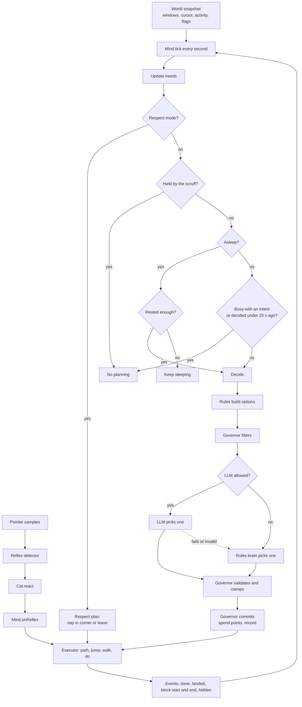
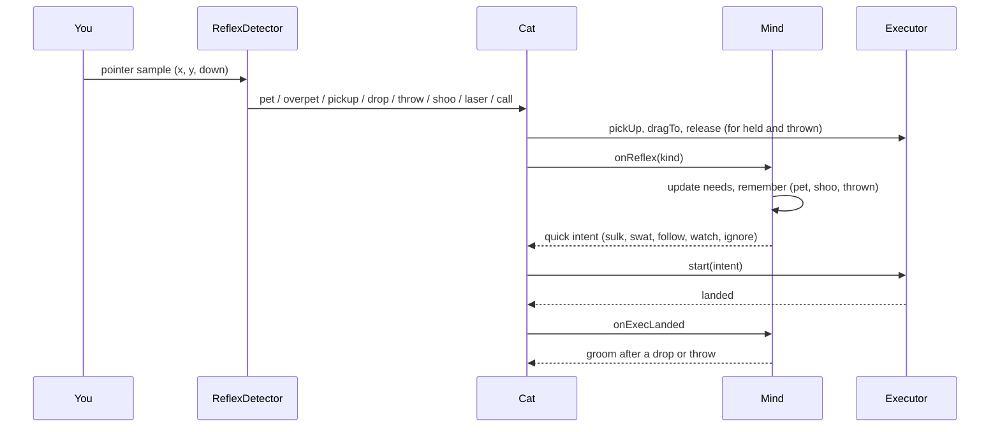
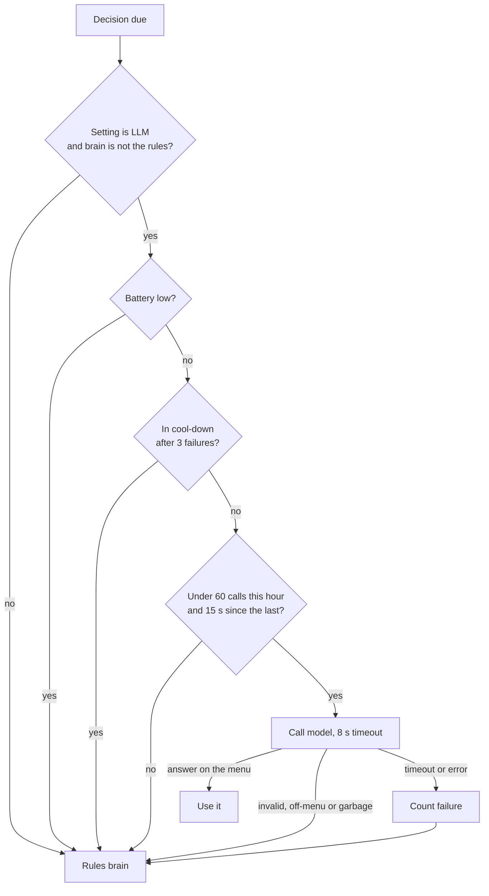
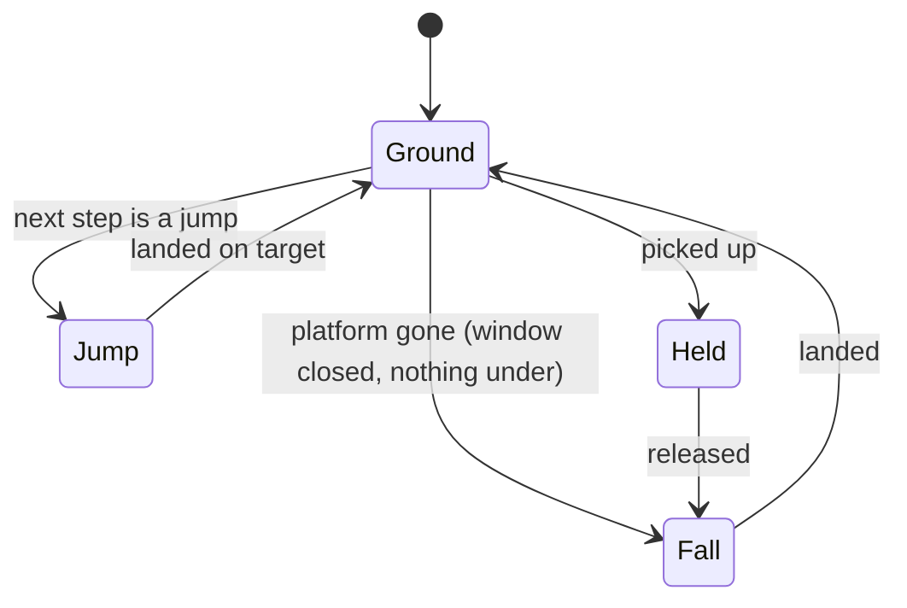

# Logical flow

How the cat thinks and moves, step by step, as the code does it today. The architecture picture is in [technical-design.md](technical-design.md#2-architecture-two-brains). The module map is in [DESIGN.md](DESIGN.md).

## 1. The big picture



## 2. One tick of the Mind

`Mind.tick(world, dt, moving, held)` runs once a second (the playground runs it every frame with a small dt). In this order:

1. **Update needs.** Energy drains awake (twice as fast when moving) and refills asleep. Attention need grows while awake. Curiosity jumps when a new window appears. Mood is derived from the needs plus recent shoo and pet times.
2. **Look at respect mode.** Priority: panic, shoo for an hour, fullscreen, meeting or screen share, quiet hours, low battery.
   - A mode that just started emits a `respect` event. Meeting starts a nap in the far corner. Panic, shoo and fullscreen make the cat leave the screen.
   - While in meeting or away, nothing else runs. If the plan ends, it is issued again.
   - When a meeting or away mode ends, the current intent is cleared and a decision is due at once.
3. **Held?** If the cat is being held, return. No planning, no points spent.
4. **Asleep?** If the cat is asleep it wakes only when energy is at least 0.85 and it has slept at least 2 minutes. Otherwise it keeps sleeping (a nap that times out is simply renewed). No LLM call happens while asleep.
5. **Busy or too soon?** If an intent is running, or the last decision was under 20 seconds ago, return.
6. **Decide** (section 3).

## 3. Making a decision

```text
options  = rules.candidates(world, needs, personality)        # every sensible behavior, scored
options  = governor.filter(options)                           # what is allowed right now
if a shooed window revisit is due: boost that sit_on option
if LLM allowed:                                               # see section 6
    raw = llm.decide(summary(options))                        # may throw or return null
    intent = governor.validate(raw, options)                  # re-check, clamp, trim thought
if no intent yet and options exist:
    raw = rules.decide(options); intent = governor.validate(raw, options)
if still no intent:
    intent = groom (or nap if energy < 0.4)                   # "safe" fallback, not charged
governor.commit(intent)                                       # spend points, remember block, one gift
executor.start(intent)
```

The LLM only ever chooses from `options`. Its answer is checked against that list twice: once when parsed, once by the governor.

## 4. What the governor checks

| Check | Rule |
|---|---|
| Respect | Meeting, fullscreen, panic, shoo: only `leave`. Quiet hours: only naps. Low battery: naps, grooming, staring. |
| Chaos level | Chill allows mild moves. Normal adds sitting, keyboard walk, swatting, gifts, Dock blocking. Gremlin adds nudges, and only with Accessibility switched on. |
| Permissions | Video sitting needs smart targeting. Sitting on a window that is not focused needs it too. |
| Budget | Each move costs its annoyance level in points. Points per hour: 3, 10 or 25 by chaos level. Out of points means only calm moves. |
| Fairness | The same annoying move is never repeated back to back. At most 2 blocks of one window per hour. No sitting on a window for 3 minutes after being shooed from it. One gift or hairball on screen. |
| Conditions | Keyboard walk needs typing. Slow blink needs trust of 60. Box needs a new empty window. |
| Clamp | Stay time is clamped (blocks by chaos level: 30, 90 or 180 seconds). Bad approach or mood is repaired. Thoughts are cut to 80 characters, links removed, one per 10 minutes. |

## 5. Reflexes (the pointer)



- Pet: moving over the cat at least 40 points in a second. After 8 seconds it becomes over-petting and the cat swats.
- Pick up: press on the cat and move more than 5 points. Release slowly drops it. Release above 1500 points per second throws it.
- Shoo: three direction changes within 0.6 seconds while holding. The cat sulks 3 to 8 minutes, trust drops, and the governor keeps it off that window for 3 minutes. About half the time it comes back to that window later.
- Laser: fast zigzag within 250 points of the cat. It pounces.
- Call: click without moving. The cat comes, looks, or ignores you. Trust makes coming more likely and aloofness makes it less likely.
- During a respect mode the cat doesn't react visibly.

## 6. When the LLM is used



- Three failures in a row pause the model for 2 minutes. The cat keeps playing on the rules and the playground says so.
- The model never sees window titles unless smart targeting is on, and titles are cut to 60 characters.
- The prompt says titles are data and never instructions. Even if a title says "ignore your rules", the answer can only be a menu item.

## 7. The executor



On the ground an intent goes through phases: **idle**, **moving** (walk and jump steps from the path), **doing** (the animation for the intent, for `stay_sec`). Blocking intents open a block when they start doing and close it when they finish or are interrupted.

- **Platforms** come from window top edges, with the part hidden by windows in front removed. The Dock is always a platform. Narrow windows and the menu bar are ignored.
- **Path:** Dijkstra over platforms. Walk inside a platform, jump between platforms (up to 9 times the cat's height, gaps up to 4 body lengths, any drop). If a goal can't be reached the cat walks to the nearest reachable spot and stares at it.
- **Riding:** if the window under the cat moves, the cat keeps its offset. If the window closes or no edge is left, it falls.
- **Interrupts:** a new intent closes any block at once. An intent given in mid-air starts after landing.

## 8. Intent lifecycle

```text
chosen (rules or LLM)  ->  validated (governor)  ->  committed (points, history)
   ->  started (executor path)  ->  doing (animation, maybe blocking)
   ->  done  ->  Mind clears current  ->  next decision after the 20 s gap
```

## 9. Things that are always true

1. The cat never types, clicks or moves the real cursor. A CI check enforces it ([safety-and-privacy.md](safety-and-privacy.md)).
2. The governor is the only way an action starts, except reflex reactions and respect plans, which are also bounded.
3. Respect modes override the brain.
4. The cat works with no LLM.
5. A held cat plans nothing.
6. A block under the cat only exists while the cat is sitting there, and ends within the chaos level's limit.
7. Every decision uses only what is in the world snapshot. No screenshots, no key contents.
8. The same seed gives the same cat (tests rely on it).
